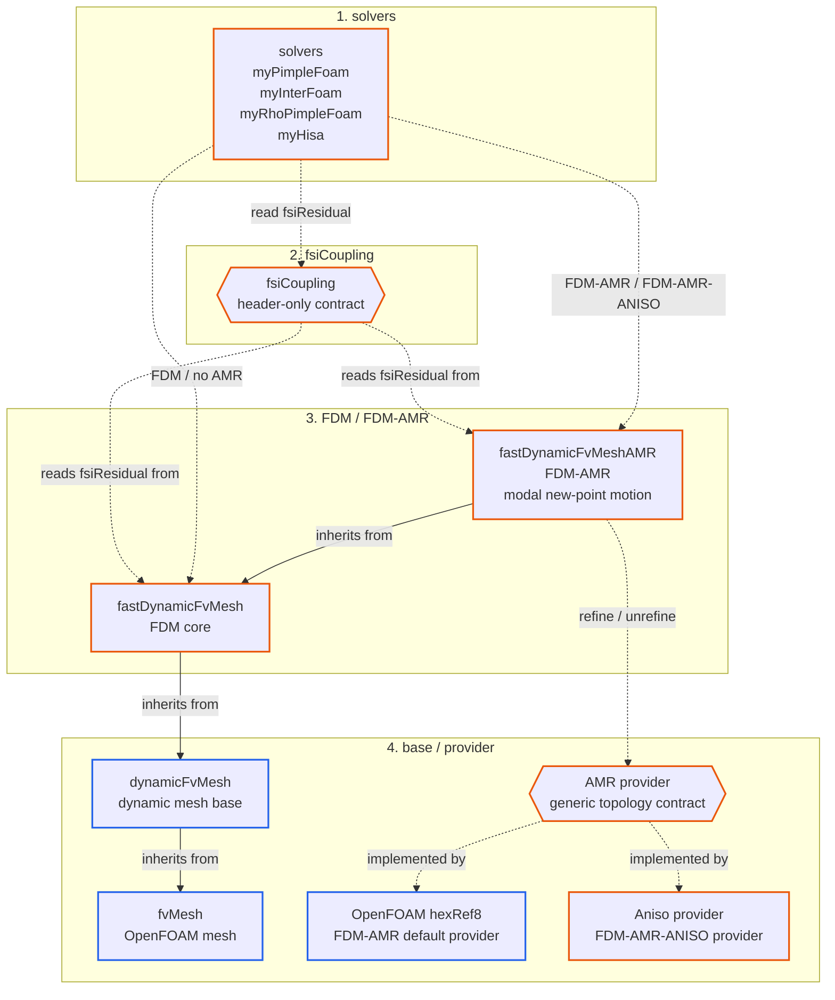

# OpenFOAM v2412 User Code

本仓库是基于 OpenFOAM v2412 的用户代码树，面向气动弹性/流固耦合（FSI）与动态网格算例的开发与验证。

## 组件

- `fastDynamicFvMesh/`：FDM core（模态/FSI）、FDM-AMR 与 Aniso 加密模块
- `fsiCoupling/`：FSI/PIMPLE 收敛契约（header-only）
- `myPimpleFoam/`：不可压 FSI 求解器（含 overset / SRF 变体）
- `myInterFoam/`：两相 VOF FSI 求解器（含 overset 变体与三相子求解器）
- `myRhoPimpleFoam/`：可压 FSI 求解器家族
- `myHisa/`：HiSA v1.12.7 副本，在伪时间循环中接入 FSI 模态力判据
- `case/`：算例生成与流水线（Python + Bash，不走 `wmake`）
  - `Damfailure/`：溃坝 FSI（FDM / preCICE）
  - `AGARD/`：AGARD 445.6 机翼（模态标定、网格工具、LFS 网格包）
  - `SwingBeam/`：封闭水箱悬臂梁 FSI（FDM / preCICE）

## 架构

FDM core 是完整的流固耦合框架：模态叠加、力投影、结构动力学、FSI 收敛和模态驱动网格运动。FDM-AMR 在 FDM core 之上，用模态信息给新点赋位置；网格拓扑由通用 AMR provider 提供。Aniso 是 provider 的一个 block 分区实现，只依赖 AMR provider 接口。

三种使用方式：

- **FDM**：只用 FDM core，无 AMR；
- **FDM-AMR**：FDM-AMR 使用默认 AMR provider（例如 OpenFOAM hexRef8）；
- **FDM-AMR-ANISO**：FDM-AMR 使用 Aniso provider。

依赖规则：

- FDM core 不依赖 FDM-AMR 或任何具体 AMR provider；
- FDM-AMR 只依赖 `AMR provider` 接口，不直接依赖具体 provider；
- Aniso 只依赖 `AMR provider` 接口，不依赖 FDM/FDM-AMR。

边框颜色：**蓝色 = OpenFOAM 提供**；**橙色 = 本工作**。

## 文档

- `AGENTS.md`：构建、验证、文件约定与协作规则
- `fastDynamicFvMesh/README.md`、`fastDynamicFvMesh/Doc/快速动网格程序手册.md`：网格库文档
- `case/*/CaseDescription.md`、`case/*/AGENTS.md`：各算例的物理说明与流水线契约
