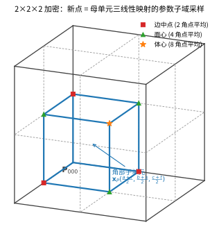
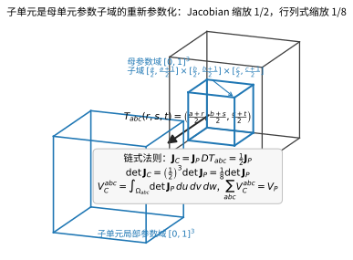
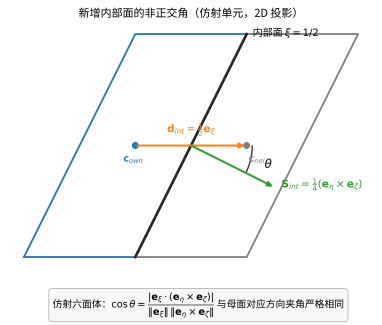
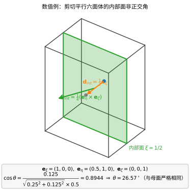
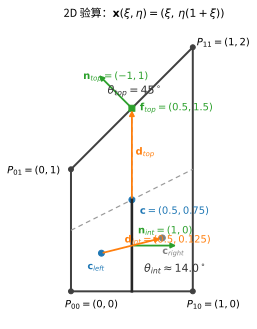
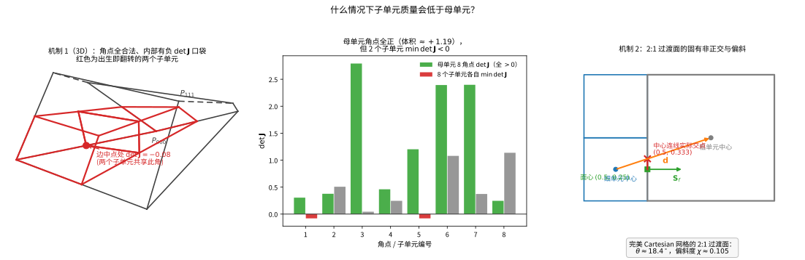

# AMR 线性插值下子网格质量与母网格质量的关系

> 本文用于**内部交流学习**，不是论文稿件。目标是把"2x2x2 线性插值加密为什么不
> 引入新的几何畸变"这件事的每一步推导都写清楚：从三线性映射的构造，到子单元
> 与母单元参数子域的严格等价，再到体积、Jacobian、纵横比、非正交性、偏斜度
> 各项质量指标分别能严格证明什么、只能估计什么。图的源码见同目录
> `Figures/amr_mesh_quality/gen_figures.py`（用 `.venv_fdm` 运行可重新生成）。

## 0. 核查结论

原始推导的大方向是对的：本代码的 2x2x2 六面体加密点（边中点、面中点、体心）
确实等价于在母六面体三线性参数映射上取子域。因此，体积、Jacobian 和局部纵横
比可以严格推导。

需要把握的是结论强度：

1. 对**仿射六面体**（平行六面体及其特例，如长方体），体积缩放、纵横比、方向
   夹角、新增内部面的非正交性、新增内部面的偏斜度都可以严格保持或严格为零。
2. 对**一般三线性六面体**，可以严格证明"子单元是母单元参数子域"，但不能对任
   意强畸变六面体严格宣称所有 `checkMesh` 指标都不超过母单元最大值。
3. 对通过 `checkMesh` 的常规 CFD 六面体，如果母单元 Jacobian 在单元内部变化
   平缓，则子单元质量与母单元同量级，线性插值加密本身不会引入新的几何畸变
   机制。

对外表述（论文或说明书）建议使用：

> 对仿射六面体，线性 2x2x2 加密严格保持形状质量；对常规小翘曲三线性六面体，
> 子单元质量由母单元局部 Jacobian 控制，通常不产生显著质量恶化。实际计算仍
> 需配合 `checkMesh`、2:1 加密约束、最大加密层数以及最小体积/边长下限。

---

## 1. 母单元三线性映射

### 1.1 定义与展开

设母六面体 8 个角点为

$$
P_{000}, P_{100}, P_{010}, P_{110},
P_{001}, P_{101}, P_{011}, P_{111}.
$$

参数坐标为 $(\xi,\eta,\zeta)\in[0,1]^3$。令

$$
N_0(q)=1-q,\qquad N_1(q)=q.
$$

母单元的三线性几何映射为

$$
\mathbf{x}_P(\xi,\eta,\zeta)
=
\sum_{i=0}^{1}\sum_{j=0}^{1}\sum_{k=0}^{1}
N_i(\xi)N_j(\eta)N_k(\zeta)\,\mathbf{P}_{ijk}.
$$

"三线性"的含义：固定任意两个参数，映射对剩下一个参数是**一次（线性）函数**。
把上式按 $\xi,\eta,\zeta$ 的各次项展开，可以写成"多线性基"形式：

$$
\mathbf{x}_P
=
\mathbf{a}_0
+\mathbf{a}_1\xi
+\mathbf{a}_2\eta
+\mathbf{a}_3\zeta
+\mathbf{a}_4\xi\eta
+\mathbf{a}_5\eta\zeta
+\mathbf{a}_6\xi\zeta
+\mathbf{a}_7\xi\eta\zeta,
$$

其中矢量系数由角点直接给出（把 $N_i$ 展开、比较各次项即可验证）：

$$
\begin{aligned}
\mathbf{a}_0 &= \mathbf{P}_{000}, &
\mathbf{a}_1 &= \mathbf{P}_{100}-\mathbf{P}_{000}, \\
\mathbf{a}_2 &= \mathbf{P}_{010}-\mathbf{P}_{000}, &
\mathbf{a}_3 &= \mathbf{P}_{001}-\mathbf{P}_{000}, \\
\mathbf{a}_4 &= \mathbf{P}_{000}-\mathbf{P}_{100}-\mathbf{P}_{010}+\mathbf{P}_{110}, &
\mathbf{a}_5 &= \mathbf{P}_{000}-\mathbf{P}_{010}-\mathbf{P}_{001}+\mathbf{P}_{011}, \\
\mathbf{a}_6 &= \mathbf{P}_{000}-\mathbf{P}_{100}-\mathbf{P}_{001}+\mathbf{P}_{101}, &
\mathbf{a}_7 &= \sum_{i,j,k\in\{0,1\}}(-1)^{3-(i+j+k)}\,\mathbf{P}_{ijk}.
\end{aligned}
$$

几何含义：

- $\mathbf{a}_1,\mathbf{a}_2,\mathbf{a}_3$ 是角点 $\mathbf{P}_{000}$ 处的三条边
  矢量（也是该点处的切向量 $\partial\mathbf{x}_P/\partial\xi$ 等）；
- $\mathbf{a}_4$ 衡量 $\zeta=0$ 面相对平行四边形的偏离：$\mathbf{a}_4=0$ 当且
  仅当 $\mathbf{P}_{000}+\mathbf{P}_{110}=\mathbf{P}_{100}+\mathbf{P}_{010}$，
  即该面四角构成平行四边形；
- $\mathbf{a}_7$ 是"三重混合"项，衡量单元相对平行六面体的总体扭曲。

### 1.2 仿射六面体作为特例

仿射六面体（平行六面体）是指可以写成

$$
\mathbf{x}_P(\xi,\eta,\zeta)
=
\mathbf{P}_{000}
+\xi\mathbf{e}_\xi
+\eta\mathbf{e}_\eta
+\zeta\mathbf{e}_\zeta
$$

的单元，其中 $\mathbf{e}_\xi,\mathbf{e}_\eta,\mathbf{e}_\zeta$ 为**常量**边矢
量。对照多线性基可知：

$$
\text{仿射}
\iff
\mathbf{a}_4=\mathbf{a}_5=\mathbf{a}_6=\mathbf{a}_7=\mathbf{0}
\iff
\mathbf{P}_{ijk}
=
\mathbf{P}_{000}+i\,\mathbf{e}_\xi+j\,\mathbf{e}_\eta+k\,\mathbf{e}_\zeta.
$$

最后一条就是"8 个角点由 1 个角点 + 3 条常量边矢量生成"，即平行六面体的定
义。长方体、直六面体都是它的特例。

### 1.3 一个容易忽视的几何事实

三线性单元的边是直线段（固定两个参数，第三个参数线性变化），但**面一般不是
平面**：例如 $\zeta=0$ 面是双线性曲面

$$
\mathbf{x}_P(\xi,\eta,0)
=
\mathbf{a}_0+\mathbf{a}_1\xi+\mathbf{a}_2\eta+\mathbf{a}_4\xi\eta,
$$

它是一个双曲抛物面（马鞍面），仅当四个角点共面（此时 $\mathbf{a}_4$ 位于角
点平面内，曲面退化为平面片）时才是平面。OpenFOAM 的离散几何把每个面按面心
三角化处理，与这里的连续三线性面模型存在 $O(\text{翘曲}^2)$ 量级的差异。本
文所有"严格"结论都在三线性模型下成立；离散实现的对应差异在 §11 说明。

---

## 2. AMR 新点等价于参数子域采样

### 2.1 子域映射

一次 2x2x2 加密把参数空间 $[0,1]^3$ 沿三个中面
$\xi=\frac12$、$\eta=\frac12$、$\zeta=\frac12$ 切成 8 个子域。对子单元编号
$(a,b,c)$，其中 $a,b,c\in\{0,1\}$，定义从子单元局部参数 $(r,s,t)\in[0,1]^3$
到母单元参数的仿射映射：

$$
T_{abc}(r,s,t)
=
\left(
\frac{a+r}{2},
\frac{b+s}{2},
\frac{c+t}{2}
\right).
$$

子单元的 8 个角点取为母单元映射在对应子域角点处的值：

$$
\mathbf{Q}^{abc}_{ijk}
=
\mathbf{x}_P\!\left(
\frac{a+i}{2},
\frac{b+j}{2},
\frac{c+k}{2}
\right),
\qquad i,j,k\in\{0,1\}.
$$

### 2.2 新点清单：27 个参数格点

加密后母单元上共有 $3\times3\times3=27$ 个参数格点
$\{0,\frac12,1\}^3$，按类型分为：

| 类型 | 参数形式 | 个数 | 角点平均规则 | 被几个子单元共享 |
|:---|:---|:---:|:---|:---:|
| 母单元角点 | $(i,j,k)$ | 8 | （原有） | 1 |
| 边中点 | 如 $(\frac12,0,0)$ | 12 | 2 个端点平均 | 2 |
| 面心 | 如 $(\frac12,\frac12,0)$ | 6 | 4 个面角点平均 | 4（面上 4 个子单元） |
| 体心 | $(\frac12,\frac12,\frac12)$ | 1 | 8 个角点平均 | 8 |

以 $(a,b,c)=(0,0,0)$ 的角部子单元为例逐一验证。$\xi$ 方向边中点：

$$
\mathbf{Q}_{100}^{000}
=
\mathbf{x}_P\left(\frac12,0,0\right)
=
N_0\left(\tfrac12\right)\mathbf{P}_{000}
+N_1\left(\tfrac12\right)\mathbf{P}_{100}
=
\frac12(\mathbf{P}_{000}+\mathbf{P}_{100}),
$$

（其余 6 项因为 $N_0(0)=1$ 乘 $N_0(0)$ 之外的因子中含 $N_1(0)=0$ 而消失。）

$\xi\eta$ 面心：

$$
\mathbf{Q}_{110}^{000}
=
\mathbf{x}_P\left(\frac12,\frac12,0\right)
=
\frac14(
\mathbf{P}_{000}+\mathbf{P}_{100}
+\mathbf{P}_{010}+\mathbf{P}_{110}),
$$

体心：

$$
\mathbf{Q}_{111}^{000}
=
\mathbf{x}_P\left(\frac12,\frac12,\frac12\right)
=
\frac18\sum_{i,j,k\in\{0,1\}}\mathbf{P}_{ijk}.
$$

因此，代码中"边中点 2 角点平均、面中点 4 角点平均、体心 8 角点平均"的规则与
三线性母单元的参数子域采样**逐点一致**。这一点不依赖面是否平面——它只是 8
个角点位置的平均规则。

图 1 展示了角部子单元的来源：新增的边中点（红方块）、面心（绿三角）和体心
（橙星）都可以写成母单元三线性映射在参数子域角点上的取值。

---

## 3. 子单元映射的严格证明

### 3.1 一个预备引理：三线性函数由角点唯一确定

**引理.** 若三线性函数 $f(\xi,\eta,\zeta)$ 在 $[0,1]^3$ 的 8 个角点处都为
零，则 $f\equiv0$。

**证明.** 分三步逐步"冻结"变量：

1. 固定 $\eta=j\in\{0,1\}$、$\zeta=k\in\{0,1\}$。则 $f(\xi,j,k)$ 是 $\xi$ 的
   一次函数，且在 $\xi=0$ 与 $\xi=1$ 处为零。一次函数由两点唯一确定，故
   $f(\xi,j,k)=0$ 对一切 $\xi\in[0,1]$ 成立。
2. 固定任意 $\xi$ 与 $\zeta=k\in\{0,1\}$。由第 1 步，$f(\xi,0,k)=f(\xi,1,k)=0$；
   而 $f(\xi,\eta,k)$ 是 $\eta$ 的一次函数，故对一切 $\eta$ 为零。
3. 固定任意 $\xi,\eta$。同理，$f(\xi,\eta,\zeta)$ 是 $\zeta$ 的一次函数且在两
   端为零，故恒为零。

于是 $f$ 在整个 $[0,1]^3$ 上为零。$\square$

**推论（唯一性）.** 两个三线性函数若在 8 个角点取值相同，则处处相同：它们
的差仍是三线性函数（三线性函数对加减封闭），且在角点为零，由引理知差恒为零。

### 3.2 主定理

子单元自身的三线性映射为

$$
\mathbf{x}_C(r,s,t)
=
\sum_{i=0}^{1}\sum_{j=0}^{1}\sum_{k=0}^{1}
N_i(r)N_j(s)N_k(t)\,\mathbf{Q}^{abc}_{ijk}.
$$

另一方面，把母单元映射限制到该子域再重新参数化，得到

$$
\widehat{\mathbf{x}}_C(r,s,t)
=
\mathbf{x}_P\bigl(T_{abc}(r,s,t)\bigr).
$$

**$\widehat{\mathbf{x}}_C$ 仍是三线性的**：$\mathbf{x}_P$ 对每个参数分别是一
次的，而 $T_{abc}$ 对每个新参数分别是仿射的（次数不超过 1），复合后对
$(r,s,t)$ 每个变量仍分别是一次——多线性性在逐变量仿射替换下保持。

并且在 8 个子单元角点 $(r,s,t)=(i,j,k)$ 上，

$$
\widehat{\mathbf{x}}_C(i,j,k)
=
\mathbf{x}_P\bigl(T_{abc}(i,j,k)\bigr)
=
\mathbf{x}_P\!\left(\frac{a+i}{2},\frac{b+j}{2},\frac{c+k}{2}\right)
=
\mathbf{Q}^{abc}_{ijk}
=
\mathbf{x}_C(i,j,k).
$$

两个三线性函数在 8 个角点相同，由 §3.1 的唯一性，它们处处相同：

$$
\boxed{
\mathbf{x}_C(r,s,t)
=
\mathbf{x}_P\!\left(
\frac{a+r}{2},
\frac{b+s}{2},
\frac{c+t}{2}
\right)
}.
$$

这一步是整个推导的核心：**子单元不是任意新造的六面体，而是母单元参数空间
中一个子域的重新参数化。** 后续所有质量指标的分析都建立在这个恒等式上。

---

## 4. Jacobian、体积与方向缩放

### 4.1 链式法则

记母单元 Jacobian（三列为三个参数方向的切向量）为

$$
\mathbf{J}_P(\xi,\eta,\zeta)
=
\left[
\frac{\partial\mathbf{x}_P}{\partial\xi},
\frac{\partial\mathbf{x}_P}{\partial\eta},
\frac{\partial\mathbf{x}_P}{\partial\zeta}
\right].
$$

子单元 Jacobian 为

$$
\mathbf{J}_C(r,s,t)
=
\left[
\frac{\partial\mathbf{x}_C}{\partial r},
\frac{\partial\mathbf{x}_C}{\partial s},
\frac{\partial\mathbf{x}_C}{\partial t}
\right].
$$

对 §3.2 的恒等式两边关于 $r$ 求导。注意 $\mathbf{x}_C$ 是
$\mathbf{x}_P$ 与 $T_{abc}$ 的复合，用链式法则：

$$
\frac{\partial\mathbf{x}_C}{\partial r}
=
\frac{\partial\mathbf{x}_P}{\partial\xi}\bigl(T_{abc}\bigr)
\cdot\frac{\partial}{\partial r}\left(\frac{a+r}{2}\right)
=
\frac12
\frac{\partial\mathbf{x}_P}{\partial\xi}\bigl(T_{abc}(r,s,t)\bigr).
$$

（$\frac{a+r}{2}$ 对 $r$ 的导数是 $\frac12$；另外两个参数方向的导数是 0，因
为 $T_{abc}$ 的三个分量各只依赖一个新参数。）对 $s,t$ 同理。写成矩阵形式即

$$
\mathbf{J}_C
=
\mathbf{J}_P\bigl(T_{abc}\bigr)
\cdot
\underbrace{\begin{bmatrix}\frac12&0&0\\0&\frac12&0\\0&0&\frac12\end{bmatrix}}_{D T_{abc}},
$$

也就是

$$
\boxed{
\mathbf{J}_C(r,s,t)
=
\frac12\,
\mathbf{J}_P\bigl(T_{abc}(r,s,t)\bigr)
}.
$$

这里的 $\frac12$ 表示 Jacobian 的**三列同时**乘以 $\frac12$。行列式是列的
三重线性函数，每列提一个 $\frac12$，共提出 $\left(\frac12\right)^3$：

$$
\det\mathbf{J}_C(r,s,t)
=
\left(\frac12\right)^3
\det\mathbf{J}_P\bigl(T_{abc}(r,s,t)\bigr)
=
\frac18
\det\mathbf{J}_P\bigl(T_{abc}(r,s,t)\bigr).
$$

### 4.2 体积积分

以下体积公式默认单元取向一致且 $\det\mathbf{J}>0$；若只讨论几何体积，可把被
积函数写成 $|\det\mathbf{J}|$，对质量合格的常规六面体两种写法等价。

子单元体积为

$$
\begin{aligned}
V_C^{abc}
&=
\int_0^1\int_0^1\int_0^1
\det\mathbf{J}_C(r,s,t)\,dr\,ds\,dt \\
&=
\frac18
\int_0^1\int_0^1\int_0^1
\det\mathbf{J}_P\bigl(T_{abc}(r,s,t)\bigr)\,dr\,ds\,dt.
\end{aligned}
$$

作变量替换

$$
u=\frac{a+r}{2},\qquad
v=\frac{b+s}{2},\qquad
w=\frac{c+t}{2},
\qquad
du=\frac{dr}{2},\quad
dv=\frac{ds}{2},\quad
dw=\frac{dt}{2},
$$

即 $dr\,ds\,dt=8\,du\,dv\,dw$，积分限 $r:0\to1$ 变为
$u:\frac{a}{2}\to\frac{a+1}{2}$（其余同理）。代入：

$$
V_C^{abc}
=
\frac18\cdot 8
\int_{a/2}^{(a+1)/2}
\int_{b/2}^{(b+1)/2}
\int_{c/2}^{(c+1)/2}
\det\mathbf{J}_P(u,v,w)\,du\,dv\,dw,
$$

前因子恰好抵消，得到

$$
\boxed{
V_C^{abc}
=
\int_{a/2}^{(a+1)/2}
\int_{b/2}^{(b+1)/2}
\int_{c/2}^{(c+1)/2}
\det\mathbf{J}_P(u,v,w)\,du\,dv\,dw
}.
$$

### 4.3 三条直接推论

1. **体积守恒。** 8 个子域把 $[0,1]^3$ 分成内部互不重叠的 8 块，积分区域拼
   合即整个参数域，所以

   $$
   \sum_{a,b,c\in\{0,1\}}V_C^{abc}
   =
   \int_0^1\int_0^1\int_0^1\det\mathbf{J}_P\,du\,dv\,dw
   =
   V_P.
   $$

2. **仿射情形严格均分。** 若母单元仿射，$\mathbf{J}_P$ 为常量矩阵，
   $\det\mathbf{J}_P=V_P$，于是每块子域积分都是
   $V_P\times\left(\frac12\right)^3$，即每个子单元体积严格为 $V_P/8$。

3. **一般情形的体积差异来源明确。** 一般三线性单元中，子单元体积的差异完
   全由 $\det\mathbf{J}_P$ 在母单元内部的起伏决定；Jacobian 越平缓，8 个子
   单元体积越接近均分。

图 2 的核心是链式法则：子单元局部坐标到母单元参数坐标的比例为 $1/2$，所以
Jacobian 三列同时缩放 $1/2$，行列式缩放 $1/8$，而体积就是 $\det\mathbf{J}_P$
在对应参数子域上的积分。

---

## 5. 纵横比推导

### 5.1 用 Jacobian 条件数定义局部纵横比

Jacobian 的奇异值 $\sigma_1\ge\sigma_2\ge\sigma_3>0$ 定义为矩阵
$\mathbf{J}^{\mathsf T}\mathbf{J}$ 特征值的算术平方根。几何上，$\sigma_{\max}$
与 $\sigma_{\min}$ 分别是参数空间单位球被 $\mathbf{J}$ 映成的椭球的最长与最
短半轴——它们度量映射在最占优方向与最退化方向上的拉伸比。定义局部（连续）
纵横比为条件数

$$
\kappa(\mathbf{J})
=
\frac{\sigma_{\max}(\mathbf{J})}
{\sigma_{\min}(\mathbf{J})}
\ge 1.
$$

$\kappa=1$ 当且仅当 $\mathbf{J}=c\mathbf{Q}$（$c>0$，$\mathbf{Q}$ 正交），即映
射局部是一个**相似变换**（均匀缩放 + 旋转/镜像），单元局部形状是立方体；
$\kappa$ 越大，局部拉伸越各向异性。

### 5.2 缩放不变性

正常数缩放不改变奇异值的比值：若 $\mathbf{J}_C=\frac12\mathbf{J}_P$，则

$$
\mathbf{J}_C^{\mathsf T}\mathbf{J}_C
=
\frac14\mathbf{J}_P^{\mathsf T}\mathbf{J}_P,
$$

特征值缩放 $\frac14$，奇异值缩放 $\frac12$：

$$
\sigma_{\max}(\mathbf{J}_C)
=
\frac12\sigma_{\max}(\mathbf{J}_P),
\qquad
\sigma_{\min}(\mathbf{J}_C)
=
\frac12\sigma_{\min}(\mathbf{J}_P),
$$

比值不变：

$$
\boxed{
\kappa(\mathbf{J}_C(r,s,t))
=
\kappa(\mathbf{J}_P(T_{abc}(r,s,t)))
}.
$$

也就是说，**子单元在任意局部位置的连续纵横比，等于母单元在对应参数位置的
连续纵横比**——逐点相等，不只是同量级。

### 5.3 一个比原文更强的精确命题

原文此处写的是"$\le$"。实际上可以写成**等式**。子单元跑遍局部参数域
$[0,1]^3$ 时，$T_{abc}$ 恰好跑遍母参数域中对应的子域
$[\frac{a}{2},\frac{a+1}{2}]\times[\frac{b}{2},\frac{b+1}{2}]\times[\frac{c}{2},\frac{c+1}{2}]$，
所以

$$
\max_{(r,s,t)\in[0,1]^3}\kappa(\mathbf{J}_C)
=
\max_{\text{对应子域}}\kappa(\mathbf{J}_P)
\le
\max_{[0,1]^3}\kappa(\mathbf{J}_P).
$$

再对 8 个子单元取最大：8 个子域的并集就是整个 $[0,1]^3$，各子域最大值中的
最大者即全域最大值，于是

$$
\boxed{
\max_{a,b,c\in\{0,1\}}
\max_{(r,s,t)\in[0,1]^3}
\kappa(\mathbf{J}_C)
=
\max_{(\xi,\eta,\zeta)\in[0,1]^3}
\kappa(\mathbf{J}_P)
}.
$$

**8 个子单元中的最差连续纵横比，恰好等于母单元的最差连续纵横比**——按这个
连续度量，2x2x2 加密既不改善也不恶化最差纵横比，它只是把母单元的最差位置
"继承"给包含该位置的那个子单元。

需要注意：OpenFOAM 的某些离散质量指标不直接使用连续 Jacobian 条件数。若指标
基于边长、面面积、体积等离散几何量，则上述"逐点相等/最差相等"不能逐字搬
运，但指标变化仍由母单元局部 Jacobian 变化控制（见 §5.4 与 §11）。

### 5.4 一般六面体的扰动界

设子域中心处

$$
\mathbf{J}_0=\mathbf{J}_P(\xi_c,\eta_c,\zeta_c),
$$

且在该子域内

$$
\|\mathbf{J}_P-\mathbf{J}_0\|_2\le\delta,
\qquad
\delta<\sigma_{\min}(\mathbf{J}_0).
$$

这里需要**Weyl 扰动定理**：对同阶矩阵 $\mathbf{A},\mathbf{E}$，奇异值满足
$|\sigma_i(\mathbf{A}+\mathbf{E})-\sigma_i(\mathbf{A})|\le\|\mathbf{E}\|_2$。
取 $\mathbf{A}=\mathbf{J}_0$、$\mathbf{E}=\mathbf{J}_P-\mathbf{J}_0$ 即得

$$
\sigma_{\max}(\mathbf{J}_P)
\le
\sigma_{\max}(\mathbf{J}_0)+\delta,
\qquad
\sigma_{\min}(\mathbf{J}_P)
\ge
\sigma_{\min}(\mathbf{J}_0)-\delta>0,
$$

从而

$$
\boxed{
\kappa(\mathbf{J}_P)
\le
\frac{\sigma_{\max}(\mathbf{J}_0)+\delta}
{\sigma_{\min}(\mathbf{J}_0)-\delta}
=
\kappa(\mathbf{J}_0)\,
\frac{1+\delta/\sigma_{\max}(\mathbf{J}_0)}
{1-\delta/\sigma_{\min}(\mathbf{J}_0)}
}.
$$

当 $\delta\ll\sigma_{\min}(\mathbf{J}_0)$ 时，右端 $\to\kappa(\mathbf{J}_0)$：
**子单元纵横比接近"局部仿射化"单元的纵横比**，偏差由子域内 Jacobian 的变
化幅度 $\delta$ 控制。这把"小翘曲网格上子单元质量不差"从直觉变成了定量估
计。

---

## 6. 非正交性推导

OpenFOAM 内部面非正交角由面积矢量 $\mathbf{S}_f$ 与相邻 cell center 连线
$\mathbf{d}$ 的夹角衡量：

$$
\cos\theta_f
=
\frac{|\mathbf{S}_f\cdot\mathbf{d}|}
{\|\mathbf{S}_f\|\,\|\mathbf{d}\|},
\qquad
\mathbf{d}
=
\mathbf{c}_{nei}-\mathbf{c}_{own}.
$$

完全正交时 $\mathbf{S}_f$ 与 $\mathbf{d}$ 平行，$\theta_f=0^\circ$；偏离越大，
非正交修正的压力项误差越大。

### 6.1 仿射六面体：严格保持

仿射母单元写为

$$
\mathbf{x}_P
=
\mathbf{P}_{000}
+\xi\mathbf{e}_\xi
+\eta\mathbf{e}_\eta
+\zeta\mathbf{e}_\zeta.
$$

考虑两个沿 $\xi$ 方向相邻的子单元，中间剖切面为 $\xi=\frac12$。推导分四步：

**第 1 步：内部面的面积矢量。** 子单元在 $\eta,\zeta$ 方向的边矢量是母单元对
应边矢量的一半（参数跨度减半、映射仿射）：$\frac12\mathbf{e}_\eta$ 与
$\frac12\mathbf{e}_\zeta$。面积矢量为两边矢量叉乘：

$$
\mathbf{S}_{int}
=
\left(\frac12\mathbf{e}_\eta\right)
\times
\left(\frac12\mathbf{e}_\zeta\right)
=
\frac14(\mathbf{e}_\eta\times\mathbf{e}_\zeta).
$$

**第 2 步：子单元中心连线。** 左右子单元的参数中心分别在 $\xi=\frac14$ 与
$\xi=\frac34$（子域 $[0,\frac12]$ 与 $[\frac12,1]$ 的中点），仿射映射下物理
中心连线为

$$
\mathbf{d}_{int}
=
\mathbf{x}_P\left(\tfrac34,\cdot,\cdot\right)
-
\mathbf{x}_P\left(\tfrac14,\cdot,\cdot\right)
=
\left(\tfrac34-\tfrac14\right)\mathbf{e}_\xi
=
\frac12\mathbf{e}_\xi.
$$

**第 3 步：代入夹角公式。**

$$
\cos\theta_{int}
=
\frac{
\left|
\frac14(\mathbf{e}_\eta\times\mathbf{e}_\zeta)
\cdot
\frac12\mathbf{e}_\xi
\right|}
{
\left\|\frac14(\mathbf{e}_\eta\times\mathbf{e}_\zeta)\right\|
\left\|\frac12\mathbf{e}_\xi\right\|
}
=
\frac{
|\mathbf{e}_\xi\cdot(\mathbf{e}_\eta\times\mathbf{e}_\zeta)|
}
{
\|\mathbf{e}_\xi\|\,
\|\mathbf{e}_\eta\times\mathbf{e}_\zeta\|
}.
$$

（分子分母的常数因子 $\frac14\cdot\frac12$ 约去。）

**第 4 步：与母面对照。** 母单元 $\xi=\text{const}$ 面的面积矢量为
$\mathbf{e}_\eta\times\mathbf{e}_\zeta$，两侧单元中心连线方向为
$\mathbf{e}_\xi$，其夹角余弦正是上式右端。因此

$$
\boxed{\theta_{int}=\theta_{parent,\xi\text{面}}}.
$$

**新增内部面的非正交角与母单元同方向外表面的非正交角严格相等**；特别地，
母单元为正交长方体时，新增内部面非正交角严格为 $0^\circ$。

图 3 用二维投影表示仿射六面体中的两个相邻子单元：面积矢量
$\mathbf{S}_{int}$ 与体心连线 $\mathbf{d}_{int}$ 相对母单元都只发生尺度缩放，
夹角不变。

### 6.2 数值例：剪切平行六面体

取

$$
\mathbf{e}_\xi=(1,0,0),\qquad
\mathbf{e}_\eta=(0.5,1,0),\qquad
\mathbf{e}_\zeta=(0,0,1).
$$

内部面 $\xi=\frac12$ 的面积矢量：

$$
\mathbf{S}_{int}
=
\frac14(\mathbf{e}_\eta\times\mathbf{e}_\zeta)
=
\frac14(1,\,-0.5,\,0)
=
(0.25,\,-0.125,\,0),
$$

（叉乘 $(0.5,1,0)\times(0,0,1)=(1\cdot1-0\cdot0,\;0\cdot0-0.5\cdot1,\;0)=(1,-0.5,0)$。）

中心连线 $\mathbf{d}_{int}=\frac12\mathbf{e}_\xi=(0.5,0,0)$。于是

$$
\cos\theta_{int}
=
\frac{|(0.25,-0.125,0)\cdot(0.5,0,0)|}
{\|(0.25,-0.125,0)\|\,\|(0.5,0,0)\|}
=
\frac{0.125}
{\sqrt{0.25^2+0.125^2}\times0.5}
=
\frac{0.125}{0.13975}
=
0.8944,
$$

即 $\theta_{int}=26.57^\circ$。直接对母面 $\xi=1$ 重复同一计算：
$\mathbf{S}=(1,-0.5,0)$、$\mathbf{d}=(1,0,0)$，
$\cos\theta=1/\sqrt{1.25}=0.8944$，同样是 $26.57^\circ$——严格相等，与
§6.1 的证明一致。

图 4 给出该数值例的空间几何：绿色半透明面为内部剖切面 $\xi=\frac12$。

### 6.3 一般三线性六面体：一阶扰动展开

一般三线性单元中，定义连续切向量

$$
\mathbf{x}_\xi
=
\frac{\partial\mathbf{x}_P}{\partial\xi},
\qquad
\mathbf{x}_\eta
=
\frac{\partial\mathbf{x}_P}{\partial\eta},
\qquad
\mathbf{x}_\zeta
=
\frac{\partial\mathbf{x}_P}{\partial\zeta},
$$

$\xi=\text{const}$ 面的连续法向为
$\mathbf{n}_\xi=\mathbf{x}_\eta\times\mathbf{x}_\zeta$。

若单元在子域内接近仿射，把切向量写成局部仿射基矢加扰动：

$$
\mathbf{x}_\xi=\mathbf{e}_\xi+\Delta_\xi,
\qquad
\mathbf{x}_\eta=\mathbf{e}_\eta+\Delta_\eta,
\qquad
\mathbf{x}_\zeta=\mathbf{e}_\zeta+\Delta_\zeta,
$$

扰动相对大小记为 $O(\epsilon)$：

$$
\frac{\|\Delta_\xi\|}{\|\mathbf{e}_\xi\|},
\;
\frac{\|\Delta_\eta\|}{\|\mathbf{e}_\eta\|},
\;
\frac{\|\Delta_\zeta\|}{\|\mathbf{e}_\zeta\|}
=
O(\epsilon).
$$

把面积矢量展开到一阶：

$$
\begin{aligned}
\mathbf{S}_{int}
&=
\frac14
(\mathbf{e}_\eta+\Delta_\eta)
\times
(\mathbf{e}_\zeta+\Delta_\zeta) \\
&=
\frac14
\underbrace{(\mathbf{e}_\eta\times\mathbf{e}_\zeta)}_{\text{仿射主项}}
+
\frac14
\underbrace{(\mathbf{e}_\eta\times\Delta_\zeta
+\Delta_\eta\times\mathbf{e}_\zeta)}_{O(\epsilon)\text{ 一阶项}}
+
\underbrace{\frac14\Delta_\eta\times\Delta_\zeta}_{O(\epsilon^2)\text{ 弃去}},
\end{aligned}
$$

即

$$
\mathbf{S}_{int}
=
\frac14(\mathbf{e}_\eta\times\mathbf{e}_\zeta)
+O(\epsilon\,\|\mathbf{e}_\eta\|\,\|\mathbf{e}_\zeta\|).
$$

同理

$$
\mathbf{d}_{int}
=
\frac12\mathbf{e}_\xi
+O(\epsilon\,\|\mathbf{e}_\xi\|).
$$

由于"归一化点积"这个函数在两个矢量都远离零时关于自变量是局部 Lipschitz 的
（可微），把 $O(\epsilon)$ 的输入扰动代入得

$$
\cos\theta_{int}
=
\cos\theta_{affine}
+O(\epsilon).
$$

这给出的是**同量级控制**，不是无条件上界。也就是说：

- 母单元小翘曲、Jacobian 平缓变化时，新增内部面的非正交性接近局部仿射结果；
- 母单元强畸变时，不能严格保证子面非正交角一定小于母单元最大非正交角；
- 工程上应通过 `checkMesh`、最大加密层数、2:1 约束、最小体积/边长下限来约
  束这类风险。

### 6.4 外表面与跨母单元面

落在母单元边界上的子面是母面的一部分。若相邻母单元也按兼容方式加密，则两
侧子面都来自各自母单元的局部参数子域，非正交性仍由两侧局部 Jacobian 控制。

但这里不能写成严格的

$$
\theta_{child}\le\theta_{parent}.
$$

原因是 OpenFOAM 的非正交性使用相邻 cell center 连线：边界子面或跨母单元子
面的 $\mathbf{d}$ 同时依赖**两侧**单元的中心位置；即使单侧子面法向来自母面
子域，也不足以单独保证非正交角不超过原母面。

更稳妥的表述是：

> 对规则小翘曲网格，边界子面和跨母单元子面的非正交性由相邻母单元的局部
> Jacobian 共同控制，通常与加密前同量级；不存在由中点线性插值单独引入的新
> 非正交来源。

---

## 7. 偏斜度推导

OpenFOAM `checkMesh` 的面偏斜度衡量：owner–neighbour 单元中心连线与面的实际
交点，偏离面心多远，用中心连线长度归一化：

$$
\chi_f
=
\frac{\|\mathbf{f}_c-\mathbf{f}_{proj}\|}
{\|\mathbf{d}\|},
$$

其中 $\mathbf{f}_c$ 是面心，$\mathbf{f}_{proj}$ 是中心连线与面（平面）的交
点。$\chi_f=0$ 表示中心连线恰好穿过面心；$\chi_f$ 大则插值格式（从单元中心
向面心插值）的实际插值点偏移，引入数值误差。

### 7.1 仿射六面体：严格为零

对仿射六面体，两个沿 $\xi$ 方向相邻的子单元中心为

$$
\mathbf{c}_{own}
=
\mathbf{x}_P\left(\frac14,\eta_c,\zeta_c\right),
\qquad
\mathbf{c}_{nei}
=
\mathbf{x}_P\left(\frac34,\eta_c,\zeta_c\right),
$$

中间面心为

$$
\mathbf{f}_c
=
\mathbf{x}_P\left(\frac12,\eta_c,\zeta_c\right).
$$

仿射映射沿 $\xi$ 是直线（线性）：

$$
\mathbf{f}_c
=
\mathbf{x}_P\left(\frac{\frac14+\frac34}{2},\eta_c,\zeta_c\right)
=
\frac12(\mathbf{c}_{own}+\mathbf{c}_{nei}),
$$

即面心恰是中心连线的中点，连线穿过面心：

$$
\boxed{\chi_f=0}.
$$

仿射六面体加密新增内部面**没有任何偏斜**。

### 7.2 一般三线性六面体

对一般三线性六面体，若用参数中心代表 cell center，沿参数方向的剖切面仍保持
对称性；但 OpenFOAM 实际使用的 cell center 是离散几何/体积加权中心，强畸变
时不必等于参数中心。因此一般情形写成扰动形式：设局部单元长度尺度为 $\ell$，

$$
\mathbf{f}_c=\mathbf{f}_{c,affine}+O(\epsilon\ell),
\qquad
\mathbf{c}_{own}=\mathbf{c}_{own,affine}+O(\epsilon\ell),
\qquad
\mathbf{c}_{nei}=\mathbf{c}_{nei,affine}+O(\epsilon\ell).
$$

于是 $\|\mathbf{f}_c-\mathbf{f}_{proj}\|=O(\epsilon\ell)$，而
$\|\mathbf{d}\|=O(\ell)$，故

$$
\chi_f=O(\epsilon).
$$

结论：小翘曲网格上新增内部面的偏斜度通常很小；极端畸变网格上不能仅凭线性
加密公式给出无条件上界。

---

## 8. 2D 验算示例

以上各节是三维一般推导。本节用一个可以手算到底的二维例子，验证"母单元畸变
明显时，内部剖切面非正交角仍可能显著小于母单元最差面"。

取二维四边形

$$
P_{00}=(0,0),\quad
P_{10}=(1,0),\quad
P_{01}=(0,1),\quad
P_{11}=(1,2).
$$

它的双线性映射为（逐角点代入可验证）：

$$
\mathbf{x}(\xi,\eta)
=
(x,y)
=
\bigl(\xi,\ \eta(1+\xi)\bigr).
$$

验证：$x$ 坐标，四个角点中只有 $P_{10},P_{11}$ 的 $x=1$，其基函数之和为
$\xi(1-\eta)+\xi\eta=\xi$；$y$ 坐标，$P_{01}$ 贡献 $(1-\xi)\eta$、$P_{11}$ 贡
献 $2\xi\eta$，合计 $\eta(1+\xi)$。

图 5 给出了本节算例的几何位置关系：母单元上边的非正交角为 $45^\circ$，而选
取的内部剖切边对应约 $14.0^\circ$。

**第 1 步：母单元上边（最差面）的非正交角。**

母单元几何中心（顶点平均，也等于 $\mathbf{x}(\frac12,\frac12)$）：

$$
\mathbf{c}
=
\frac14(P_{00}+P_{10}+P_{01}+P_{11})
=
(0.5,\ 0.75).
$$

上边 $\eta=1$ 的边心：

$$
\mathbf{f}_{top}
=
\frac12(P_{01}+P_{11})
=
(0.5,\ 1.5).
$$

上边切向量 $\mathbf{t}_{top}=P_{11}-P_{01}=(1,1)$，取法向
$\mathbf{n}_{top}=(-1,1)$（点积 $(1,1)\cdot(-1,1)=0$，确为法向）。从单元中
心指向面心：

$$
\mathbf{d}_{top}
=
\mathbf{f}_{top}-\mathbf{c}
=
(0,\ 0.75).
$$

因此

$$
\cos\theta_{top}
=
\frac{|\mathbf{n}_{top}\cdot\mathbf{d}_{top}|}
{\|\mathbf{n}_{top}\|\,\|\mathbf{d}_{top}\|}
=
\frac{0.75}{\sqrt{2}\times0.75}
=
\frac1{\sqrt{2}}
\;\Rightarrow\;
\theta_{top}=45^\circ.
$$

**第 2 步：内部剖切边的非正交角。**

取内部剖切边 $\xi=\frac12,\ \eta\in[0,\frac12]$。两端点：

$$
\mathbf{x}\left(\frac12,0\right)=(0.5,\ 0),
\qquad
\mathbf{x}\left(\frac12,\frac12\right)=(0.5,\ 0.75),
$$

是竖直边，法向取 $\mathbf{n}_{int}=(1,0)$。

左右两个子单元的参数中心分别为 $(\frac14,\frac14)$ 与 $(\frac34,\frac14)$，
映到物理空间：

$$
\mathbf{c}_{left}
=
\mathbf{x}\left(\frac14,\frac14\right)
=
\left(0.25,\ 0.25\times1.25\right)
=
(0.25,\ 0.3125),
$$

$$
\mathbf{c}_{right}
=
\mathbf{x}\left(\frac34,\frac14\right)
=
\left(0.75,\ 0.25\times1.75\right)
=
(0.75,\ 0.4375).
$$

中心连线：

$$
\mathbf{d}_{int}
=
\mathbf{c}_{right}-\mathbf{c}_{left}
=
(0.5,\ 0.125).
$$

于是

$$
\cos\theta_{int}
=
\frac{|(1,0)\cdot(0.5,0.125)|}
{\|(1,0)\|\,\|(0.5,0.125)\|}
=
\frac{0.5}{\sqrt{0.5^2+0.125^2}}
=
\frac{0.5}{0.51539}
\approx
0.9701
\;\Rightarrow\;
\theta_{int}\approx14.0^\circ.
$$

**第 3 步：解读。** 母单元上边非正交角 $45^\circ$，内部剖切边只有
$14.0^\circ$。这与 §5.3 的精确命题并不矛盾：§5.3 说的是连续条件数 $\kappa$
的最差值在母子之间**相等**——该梯形的最差位置确实被某个子单元继承；而
OpenFOAM 的非正交角是定义在"特定面 + 中心连线"上的离散指标，与 $\kappa$ 的
峰值位置不必重合。这个例子的教益是双向的：

- 内部面的非正交性**可能远好于**母单元最差外表面；
- 但它只是例子，不是任意强畸变六面体的全局保证；离散指标的无条件上界不存
  在，工程上仍靠 `checkMesh` 把关。

---

## 9. 什么时候子单元质量会比母单元差？

前面的严格结论都建立在"仿射"（精确）或"小翘曲"（一阶）前提上。本节列出子
单元质量确实会低于母单元的情形，并用图 6 示意其中两种最典型的机制。

图 6 展示了两种典型失效机制：左图与中图是一个真实的三维反例——母单元 8 个
角点 $\det\mathbf{J}$ 全正、总体积为正，但内部有负 $\det\mathbf{J}$ 口袋，
两个子单元出生即翻转；右图是完美 Cartesian 网格在 2:1 过渡面上固有产生的
非正交与偏斜。

### 9.1 母单元接近有效性边界（强翘曲）：一个纯三维的失效模式

§5.4 的扰动界

$$
\kappa(\mathbf{J}_P)
\le
\frac{\sigma_{\max}(\mathbf{J}_0)+\delta}
{\sigma_{\min}(\mathbf{J}_0)-\delta}
$$

的分母随 $\delta\to\sigma_{\min}(\mathbf{J}_0)$ 趋于零：母单元 Jacobian 在单
元内变化越剧烈，子单元质量的上界越差。极端情形是子单元出生即翻转
（$\det\mathbf{J}<0$）。这里有一个**二维与三维的本质区别**，值得单独讲清
楚。

**为什么二维不会出现这种情况。** 双线性映射的 $\det\mathbf{J}$ 本身也是
**双线性**函数（2x2 Jacobian 的每个元素只含另一参数的一次项，乘积相减后仍
是双线性的）。双线性函数的 Hesse 矩阵处处不定（零对角），没有内部局部极
值；它在每条边上是一次函数。因此它在整个参数正方形上的**最小值一定在某个
角点取得**：

$$
\min_{[0,1]^2}\det\mathbf{J}
=
\min_{\text{4 角点}}\det\mathbf{J}.
$$

推论：角点构成凸四边形（等价于四角 $\det\mathbf{J}>0$）的母单元，其映射
**绝不可能在内部折叠**，子单元也必然全部合法。二维里不存在"角点全合法、内
部翻转"的单元。

**为什么三维可以。** 三线性映射 Jacobian 的每个元素对另外两个参数是双线性
的，而行列式是这些元素的**乘积之和**——$\det\mathbf{J}$ 是每个参数**次数
≤2** 的多项式，不再是多线性函数，上述"角点取得最值"的论证失效。哪怕只看一
条边：$\det\mathbf{J}$ 沿边是该边参数的**二次**函数，二次抛物线可以在边中
点跌破两个端点的值。所以三维里可以存在：

- 8 个角点 $\det\mathbf{J}$ 全部为正（每个角附近都是合法单元）；
- 角点构成凸多面体，母单元总体积
  $V=\int\det\mathbf{J}\,d\xi d\eta d\zeta$ 为正；
- 但内部（或边中点）存在 $\det\mathbf{J}<0$ 的"口袋"。

**回答一个常见疑问：这种母单元是不是已经是负体积了？** 不是。$\det\mathbf{J}$
是**局部体积缩放率**（逐点的密度型量），不是单元体积；单元体积是它的积分。
图 6 左/中的实例（随机搜索找到并验证）：8 个角点 $\det\mathbf{J}\in[0.25,2.79]$
全正，母单元体积 $\approx+1.19$，但底前边中点处 $\det\mathbf{J}=-0.08$——
负口袋只占单元内部一小片，积分后总体积仍为正，`checkMesh` 在体心/面心处的
采样也完全可能错过它。这个母单元"看起来还能用"。

**加密发生了什么。** 那个边中点正是 2x2x2 加密后两个子单元共享的角点：两个
子单元一出生就在该角处 $\det\mathbf{J}<0$，即局部翻转（图 6 中红色子单
元）。母单元里"藏"着的有效性缺陷，被加密显影成了实实在在的坏子单元。这也
是为什么 AMR 流程必须在加密后对**子单元**跑 `checkMesh`，而不能只信母网格
的检查结果。

### 9.2 2:1 加密过渡面（悬挂节点界面）的固有劣化

即使母网格是**完美的 Cartesian 网格**，粗细单元 2:1 过渡面上也会产生非零的
非正交角和偏斜度（图 6 右）：OpenFOAM 把粗面拆成与细面一一配对的子面，但
owner 侧单元中心仍是粗单元中心，于是中心连线 $\mathbf{d}$ 不再穿过细面心中
心。图 6 右的算例给出 $\theta\approx18.4^\circ$、$\chi\approx0.105$。

这与线性插值误差无关，是**非保角拓扑的固有代价**：粗、细单元中心的几何位置
天然错开。2:1 平衡约束（相邻单元最多差一级）把这类劣化限制在单层过渡面上，
不随加密层数累积放大。

### 9.3 双单元离散指标没有母子包含关系

非正交性和偏斜度都是**两个单元共同决定**的量（依赖 owner–neighbour 中心连
线）。母单元边界面指标用的是"母单元中心→面心"，子单元内部面指标用的是"子
单元中心→子单元中心"，是不同的矢量，不存在"子指标不超过母指标"的包含关
系（§6.3、§6.4）。规则网格上经验通常是同量级甚至更好（§8 的例子从
$45^\circ$ 改善到 $14^\circ$），但理论上可以更差，且无无条件上界。

### 9.4 边界几何的弦化（曲率保真度）

线性中点落在线段（弦）上，而不是真实曲面/特征线上。位于弯曲壁面或自由液面
附近的单元加密后，新增边界点内缩，相邻子面之间产生折角，边界贴体性下降。
这属于几何保真度问题，§1–§8 的三线性子域理论管不到它；曲率半径相对单元尺
度越小越明显，需要用边界层细化或几何投影（snappy 类流程）而不是靠 AMR 中点
插值解决。

### 9.5 工程层面的放大项

- **unrefine 后再 refine**：`pointsFromPoints` 谱系权重非均匀时，"边中点"不
  再是严格中点，子单元形状偏离理想参数子域；
- **深层加密的累积**：极小单元上，浮点舍入、流场向新点的插值误差相对单元尺
  度放大；
- **后续网格运动**：本库的模态位移叠加在极小单元上，同样的
  `maxDispChange` 相对单元尺度的影响更大，可能把原本合格的子单元压坏。

### 9.6 共同点

机制 9.1、9.2 是"母单元或网格拓扑本身已有隐患，加密把它显影出来"；机制
9.3–9.5 是离散指标与工程流程的固有边界。线性插值本身在合法的小翘曲单元上
不制造新的畸变机制——这正是 §0 结论的适用边界，也是
`refinementMinCellVolume`、`refinementMinEdgeLength`、`maxRefinement` 和
`checkMesh` 这些护栏存在的理由。

---

## 10. 多次加密

第 $n$ 次加密后的子单元仍是初始母单元参数空间中的子域，参数边长为

$$
h=2^{-n}.
$$

**仿射情形**：Jacobian 始终只做整体缩放，

$$
\mathbf{J}_{C_n}
=
h\,\mathbf{J}_P,
\qquad
V_{C_n}
=
h^3V_P
=
2^{-3n}V_P,
$$

形状质量（条件数、方向夹角、非正交、偏斜）在每一级都严格保持。

**一般三线性情形**：三线性映射的 Jacobian 是参数的连续（事实上是多线性）函
数，因此在紧参数域上 Lipschitz 连续：存在常数 $L$ 使

$$
\|\mathbf{J}_P(\mathbf{q}_1)-\mathbf{J}_P(\mathbf{q}_2)\|
\le
L\|\mathbf{q}_1-\mathbf{q}_2\|.
$$

边长 $h$ 的参数子立方体中，任意两点距离不超过体对角线 $\sqrt{3}\,h$，故子
域内 Jacobian 变化满足

$$
\delta_h
\le
L\sqrt{3}\,h.
$$

代入 §5.4 的扰动界：随着 $n$ 增大，$\delta_h\to0$，每个子单元越来越接近"局
部仿射单元"，其纵横比、非正交性、偏斜度都趋向该处局部仿射化的值。

这解释了 AMR 实践中观察到的现象：**对光滑小翘曲网格，加密本身有"自修正"倾
向**——越深的加密层级，单元越接近均匀仿射微元。但工程上仍要限制最大加密层
数与最小尺度，原因不在几何推导，而在于：流场插值误差、边界/挡板几何分辨率、
并行分区平衡、以及后续网格运动（本库的模态位移叠加）对极小单元的放大效应。

---

## 11. 与代码实现的对应

本节的目的是把上面的数学对象锚定到 `fastDynamicFvMesh` 的实现
（`fastDynamicFvMesh/fastDynamicFvMesh/fastDynamicFvMeshModeMapping.C` 与
`fastDynamicFvMeshAMR.C`）：

1. **新点生成规则**对应 §2.2：边中点取 2 端点平均、面中点取 4 角点平均、体
   心取 8 角点平均。实现里 AMR 新增点通过多轮 2/4/8 角点分类补齐：先用
   `mapPolyMesh::pointsFromPoints` 的拓扑谱系（带权重，普通 2:1 加密时权重均
   匀，即算术平均），无法直接谱系恢复的点再按边/面/体角点规则多轮插值，且
   **禁止几何最近邻回退**（代码中有 `FatalError` 强制）。
2. **参数子域等价（§3）**是"可以安全地用母单元模态值插值子单元点"的几何依
   据：模态形状在新点处的取值等价于在母单元参数子域上采样，这与本库
   `ensureModeShapesForCurrentMesh()` 的拓扑插值路径一致。
3. **体积/Jacobian 缩放（§4）**对应运行时 AMR 后模态力投影的参考面重构：细
   化面上的力先聚合回初始参考 FSI 面（面积权重来自拓扑谱系），§4.3 的体积守
   恒保证了聚合权重的一致性。
4. **离散与连续模型的差异（§1.3）**：OpenFOAM 面按面心三角化，本文的"严格"
   结论在三线性连续模型下成立；两者差异为面翘曲的高阶小量，常规 CFD 网格可
   忽略，强翘曲网格上应以 `checkMesh` 的离散指标为准。
5. **工程护栏（§5.4、§6.3、§7.2 的 $O(\epsilon)$ 项）**：对应
   `dynamicMeshDict` 中的 `refinementMinCellVolume`、
   `refinementMinEdgeLength`、`maxRefinement`、`maxCells` 与 2:1 一致性约束，
   以及 `checkMesh` 验收。护栏针对的失效模式（有效性边界、2:1 过渡面、弦化、
   工程放大项）集中在 §9。

---

## 12. 总结

| 质量指标 | 仿射六面体 | 一般三线性六面体（规则网格、小翘曲） |
|:---|:---|:---|
| 子单元几何 | 严格为母单元子域 | 严格为母单元参数子域（§3 主定理） |
| 体积 | 每个子单元严格 $V_P/8$ | $\sum V_C^{abc}=V_P$ 严格成立；单个体积由 $\det\mathbf{J}$ 局部变化决定 |
| 连续纵横比 $\kappa(\mathbf{J})$ | 逐点不变 | 子单元逐点等于母单元对应参数位置；**8 子单元最差值 = 母单元最差值**（§5.3） |
| 离散纵横比类指标 | 同量级保持 | 由 Jacobian 扰动界控制（§5.4） |
| 新增内部面非正交性 | 严格等于母单元同方向面夹角（§6.1–6.2） | 与局部仿射结果相差 $O(\epsilon)$（§6.3） |
| 新增内部面偏斜度 | 严格为 0 | 通常 $O(\epsilon)$ |
| 外表面/跨母单元面 | 兼容仿射网格下同量级或保持 | 由两侧母单元局部 Jacobian 共同控制，不宜宣称无条件上界 |
| 多级加密 | 各级严格保持 | 子单元随层级增加趋向局部仿射微元（$\delta_h\le L\sqrt3\,h$） |
| 子单元何时会更差 | 不会（仿射下严格保持） | 见 §9：有效性边界、2:1 过渡面、双单元指标无包含关系、边界弦化、工程放大项 |

最终可用结论：

> 本代码采用的 AMR 线性插值加密在几何上等价于三线性母单元的参数子域划分。
> 对仿射六面体，各主要形状指标可严格保持；对常规小翘曲 CFD 六面体，子单元
> 质量由母单元局部 Jacobian 变化控制，通常不会产生显著恶化。严格工程保证仍
> 依赖 `checkMesh`、2:1 约束、最大加密层数、`refinementMinCellVolume` 和
> `refinementMinEdgeLength` 等控制。
